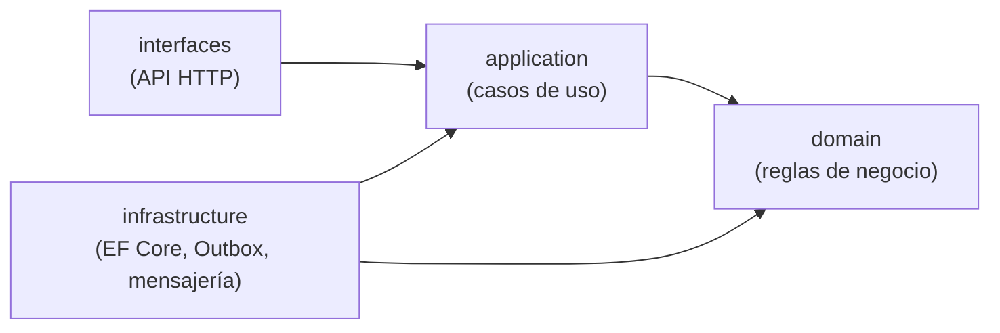

# ShareWay · Trip Execution Service

Microservicio del bounded context **Trip Execution** de **ShareWay**, una plataforma de viajes compartidos programados en Lima (tipo Uber, pero con viaje compartido). Se encarga de la **ejecución del viaje**: validar el abordaje de los pasajeros, iniciar y finalizar el viaje, y publicar los eventos que el resto del ecosistema necesita.

> El contexto original del diagrama es *Trip Execution & Notifications*. Este servicio implementa la parte de **Trip Execution**. Las **notificaciones** quedan fuera: se resolverán en un servicio aparte que consumirá los eventos que este servicio publica.

---

## Tabla de contenidos

1. [Alcance y responsabilidades](#1-alcance-y-responsabilidades)
2. [Arquitectura](#2-arquitectura)
3. [Modelo de dominio](#3-modelo-de-dominio)
4. [Eventos e integración](#4-eventos-e-integración)
5. [API HTTP](#5-api-http)
6. [Dependencias y stack](#6-dependencias-y-stack)
7. [Servicios de infraestructura](#7-servicios-de-infraestructura)
8. [Configuración](#8-configuración)
9. [Cómo ejecutarlo](#9-cómo-ejecutarlo)
10. [Documentación de la API](#10-documentación-de-la-api)
11. [Base de datos](#11-base-de-datos)
12. [Despliegue en Render](#12-despliegue-en-render)
13. [Decisiones de diseño](#13-decisiones-de-diseño)
14. [Limitaciones y próximos pasos](#14-limitaciones-y-próximos-pasos)

---

## 1. Alcance y responsabilidades

| Dentro del servicio | Fuera del servicio |
|---|---|
| Crear el viaje a partir de un grupo confirmado | Matching y armado de grupos (*Ride Booking & Matching*) |
| Validar el abordaje con código QR/PIN, con límite de intentos | Propuestas y rutas del conductor (*Driver Operations & Routing*) |
| Iniciar, finalizar y cancelar el viaje | Cálculo y cobro de tarifas (*Pricing & Payments*) |
| Publicar eventos de integración (Outbox) | Alertas de emergencia y calificaciones (*Safety, Trust & Reputation*) |
| Consumir `GrupoConfirmado` de forma idempotente | Envío de notificaciones (servicio futuro) |

Los demás contextos se relacionan con este solo **por identificadores** (`GrupoId`, `ConductorId`, `ReservaId`, `PasajeroId`) y **por eventos**; nunca por referencias a objetos de otro contexto.

---

## 2. Arquitectura

Se aplica **DDD táctico + Clean Architecture** en un **único proyecto** (`shareway-trip-execution-service.csproj`) organizado por carpetas.



**Regla de dependencia:** las flechas apuntan hacia el dominio. `domain` no conoce a nadie; `application` solo conoce a `domain`; `infrastructure` e `interfaces` dependen hacia adentro.

### Estructura de carpetas

```
TripExecution/
├── domain/
│   ├── SeedWork/            Entidad, raíz de agregado, eventos y excepciones base
│   └── viajes/              Aggregate Viaje, entidades, value objects, eventos, puertos
├── application/
│   ├── Abstracciones/       Puertos: unidad de trabajo, manejadores de comando/consulta
│   ├── Viajes/              Comandos y consultas (un caso de uso por carpeta)
│   ├── EventosDeIntegracion/  Contratos entrantes y salientes + mapeador
│   └── Excepciones/
├── infrastructure/
│   ├── Persistencia/        DbContext, configuraciones EF, repositorios, Outbox
│   └── Mensajeria/          Procesador del Outbox, adaptador de broker, consumidores
├── interfaces/
│   ├── Endpoints/           Minimal APIs
│   ├── Contratos/           Requests/responses HTTP
│   └── Middleware/          Manejo global de excepciones (ProblemDetails)
├── Program.cs               Composición de dependencias y arranque
├── Dockerfile
├── docker-compose.yml
└── appsettings*.json
```

### Patrones aplicados

| Patrón | Dónde |
|---|---|
| **Aggregate Root** | `Viaje`: único punto de entrada para modificar su estado interno |
| **Value Objects** | `CodigoAbordaje` (hash del PIN/QR) y los identificadores tipados |
| **Eventos de dominio** | El aggregate los levanta en cada transición de estado |
| **CQRS ligero** | Comandos (cambian estado, pasan por el aggregate) separados de consultas |
| **Outbox** | Los eventos se guardan en la misma transacción que el cambio de estado |
| **Repositorio + Unidad de trabajo** | Puertos en `domain`/`application`, implementados en `infrastructure` |
| **Concurrencia optimista** | Token de versión en `Viaje` para evitar saltarse el límite de intentos |

> **Importante:** al ser un solo ensamblado, el compilador ya no impide que una capa dependa de otra. Mantén la disciplina: **toda mutación del aggregate entra por `Viaje`** y `domain` no debe importar nada de `application`, `infrastructure` ni `interfaces`. Conviene reforzarlo con un test de arquitectura (NetArchTest filtrando por namespace).

---

## 3. Modelo de dominio

### Aggregate `Viaje`

Representa la ejecución de un viaje confirmado.

| Elemento | Tipo | Descripción |
|---|---|---|
| `Viaje` | Aggregate Root | Estado del viaje, conductor, grupo e instantes reales de inicio y fin |
| `Abordaje` | Entidad (interna) | Una por reserva: código, intentos fallidos, método y hora de abordaje |
| `CodigoAbordaje` | Value Object | Código almacenado solo como **hash** (SHA-256) |
| `EstadoViaje` | Enum | `Confirmado → EnCurso → Finalizado` o `Cancelado` |
| `MetodoAbordaje` | Enum | `Qr`, `Pin` |
| `ResultadoAbordaje` | Enum | `Abordado`, `YaAbordado`, `CodigoInvalido`, `Bloqueado` |

### Reglas de negocio (invariantes)

- Solo el **conductor asignado** puede operar el viaje.
- Transiciones válidas: `Confirmado → EnCurso → Finalizado`, o `Confirmado → Cancelado`.
- No se puede iniciar un viaje sin al menos un pasajero abordado.
- Un abordaje se **bloquea tras 3 intentos fallidos**.
- Un código inválido **no lanza excepción**: devuelve `CodigoInvalido` para que el intento quede persistido.
- El abordaje es idempotente: repetirlo devuelve `YaAbordado`.

### Eventos de dominio

`ViajeCreado` · `ViajeIniciado` · `PasajeroAbordo` · `AbordajeFallido` · `ViajeFinalizado` · `ViajeCancelado`

### Lenguaje ubicuo

El código usa el vocabulario del negocio en **español** (`Viaje`, `Abordaje`, `Conductor`, `Reserva`), igual que el modelo de dominio del proyecto. Se evita mezclar con términos en inglés dentro del dominio.

---

## 4. Eventos e integración

### Evento entrante

| Evento | Origen | Efecto |
|---|---|---|
| `GrupoConfirmado` | Ride Booking & Matching | Crea el `Viaje` en estado `Confirmado`. **Idempotente** (un grupo genera un único viaje, protegido también por índice único en BD). |

El contrato incluye `grupoId`, `conductorId` y, por cada pasajero, `reservaId`, `pasajeroId` y `codigoHash`. Este servicio **nunca ve el código en claro** hasta que el conductor lo escanea o digita.

### Eventos salientes (Outbox)

Los eventos de dominio se traducen a **eventos de integración** (contrato público, solo tipos primitivos) y se guardan en la tabla `outbox` dentro de la misma transacción. Un proceso en segundo plano (`ProcesadorOutbox`) los publica cada ~2 segundos con semántica *al menos una vez*, por lo que los consumidores deben ser idempotentes (cada evento lleva `IdEvento`).

| Evento de integración | Consumidores previstos |
|---|---|
| `ViajeCreado` | — |
| `ViajeIniciado` | Notifications, Safety |
| `PasajeroAbordo` | Notifications |
| `AbordajeFallido` | Safety |
| `ViajeFinalizado` | Pricing & Payments, Reputación, Notifications |
| `ViajeCancelado` | Notifications, Pricing |

> Hoy el adaptador de broker (`IBrokerDeMensajes`) **escribe en el log** (`[BROKER] ...`). Para producción hay que implementarlo contra el broker real (RabbitMQ, Azure Service Bus, Kafka…).

---

## 5. API HTTP

Base: `/api/viajes`. Los comandos devuelven `204 No Content` (o el resultado correspondiente) y los errores usan **ProblemDetails** (RFC 9457).

| Método | Ruta | Descripción |
|---|---|---|
| `POST` | `/api/viajes` | Simula un viaje confirmado (solo `ADMIN`); acepta `ruta` opcional con horario, etiquetas y puntos |
| `GET` | `/api/viajes/mine` | Lista los viajes del conductor autenticado (`DRIVER`), filtrados por el `sub` del JWT |
| `GET` | `/api/viajes/{id}` | Consulta el viaje asignado al conductor autenticado (`DRIVER`) |
| `POST` | `/api/viajes/{id}/abordajes` | Valida un abordaje como conductor asignado (`DRIVER`); la identidad viene del JWT |
| `POST` | `/api/viajes/{id}/iniciar` | Inicia el viaje como conductor asignado (`DRIVER`); la identidad viene del JWT |
| `POST` | `/api/viajes/{id}/finalizar` | Finaliza el viaje como conductor asignado (`DRIVER`); la identidad viene del JWT |
| `POST` | `/api/viajes/{id}/cancelar` | Cancela el viaje confirmado como `ADMIN` o como conductor asignado |
| `POST` | `/api/viajes/{id}/ruta/optimizar` | Reordena las paradas de la ruta (`DRIVER` asignado) |
| `POST` | `/api/viajes/{id}/paradas/cancelar` | Quita la parada de un pasajero y recalcula la ruta sin cancelar el viaje (`DRIVER` asignado o `ADMIN`) |
| `GET` | `/api/viajes/admin` | Listado admin con filtros opcionales `conductorId` y `pasajeroId` (`ADMIN`) |
| `POST` | `/api/viajes/{id}/alertas` | Registra una alerta de emergencia desde el viaje (`DRIVER` asignado o `PASSENGER` con abordaje) |
| `GET` | `/api/viajes/alertas` | Lista las alertas de emergencia, filtrables por `estado` y paginadas (`ADMIN`) |
| `PATCH` | `/api/viajes/alertas/{id}/atender` | Marca una alerta como atendida (`ADMIN`) |
| `GET` | `/health` | Chequeo de salud |

El `POST /api/viajes` acepta un `vehiculoId` opcional: Trip Execution guarda únicamente el id histórico del vehículo con el que se registra el viaje; los datos (placa, marca, modelo) viven en **Driver Management** y el panel los rehidrata al vuelo. Las respuestas de `GET {id}`, `/mine` y `/admin` devuelven `vehiculoId: null` cuando el viaje no tenía uno.

Los endpoints protegidos requieren `Authorization: Bearer <token>` firmado con HS256. La clave se lee de `JWT_SECRET` o, si no existe, de `Jwt:Key` (`Jwt__Key` en Render), y debe coincidir con la del Gateway. Si se configuran `Jwt:Issuer` (`Jwt__Issuer`) y `Jwt:Audience` (`Jwt__Audience`), también se validan. El servicio valida firma, vigencia, UUID en `sub` y rol (`ADMIN` o `DRIVER`). El endpoint `/health` continúa público.

`ruta` usa este formato: `salidaProgramada` (ISO 8601), `origen`, `destino`, `esPrueba` y `puntos`, donde cada punto contiene `etiqueta`, `latitud`, `longitud` y `tipo` (`ORIGEN`, `PARADA` o `DESTINO`). El primer punto debe ser el origen y el último, el destino. Los viajes históricos sin estos datos devuelven `ruta: null`.

### Mapeo de errores

| Situación | Código HTTP |
|---|---|
| Viaje inexistente | `404` |
| Conductor no asignado al viaje | `403` |
| Regla de negocio violada / transición inválida / conflicto de concurrencia | `409` |
| Datos de entrada inválidos | `400` |
| Error inesperado | `500` |

El `conductorId` del endpoint de simulación solo lo puede asignar un `ADMIN`. En los comandos de ejecución se ignora cualquier identidad del body: el servicio usa el UUID del `sub` validado y comprueba que corresponda al conductor asignado.

---

## 6. Dependencias y stack

| Componente | Versión / detalle |
|---|---|
| Plataforma | **.NET 10** / ASP.NET Core (Minimal APIs) |
| Lenguaje | C# (versión más reciente del SDK) |
| Persistencia | **Entity Framework Core 10** + proveedor **Npgsql** |
| Base de datos | **PostgreSQL 17** |
| Documentación API | OpenAPI nativo de .NET (`AddOpenApi`) |
| Contenedores | Docker y Docker Compose |
| Hosting de pruebas | Render |

Las versiones exactas están en el `.csproj`. Para revisar actualizaciones: `dotnet list package --outdated`.

**Sin dependencias de mensajería ni de CQRS de terceros:** los manejadores de comandos y consultas son clases propias (sin MediatR) y el broker está detrás de una interfaz.

---

## 7. Servicios de infraestructura

| Servicio | Rol | Local | Puerto |
|---|---|---|---|
| `db` | PostgreSQL con la base `shareway_trip_execution` | Docker Compose | `5432` |
| `api` | Este microservicio | `dotnet run` o Docker Compose | `5223` (dotnet run) / `8080` (Docker) |
| Broker | Publicación de eventos de integración | Adaptador que escribe en el log | — |

---

## 8. Configuración

| Variable | Descripción | Ejemplo |
|---|---|---|
| `ConnectionStrings__TripExecution` | Conexión a PostgreSQL. Acepta formato Npgsql o URL `postgresql://` | `Host=localhost;Port=5432;Database=shareway_trip_execution;Username=postgres;Password=postgres` |
| `ASPNETCORE_ENVIRONMENT` | Entorno. En `Development` se crean las tablas al arrancar y se expone OpenAPI | `Development` |
| `Database__AutoCreate` | Si es `true`, ejecuta `EnsureCreated` también fuera de `Development` (lo usa el Blueprint de Render) | `true` en Render |
| `Swagger__Enabled` | Si es `true`, expone OpenAPI/Swagger UI fuera de `Development` | `true` en Render |
| `PORT` | Puerto de escucha (lo usa Render) | `8080` |
| `JWT_SECRET` o `Jwt__Key` | Clave HS256 compartida con el Gateway para validar tokens. `JWT_SECRET` tiene prioridad | Configurar como secreto del entorno; no versionar |
| `Jwt__Issuer` | Emisor esperado del JWT; se valida cuando está configurado | Configurar igual que el Gateway |
| `Jwt__Audience` | Audiencia esperada del JWT; se valida cuando está configurada | Configurar igual que el Gateway |

`appsettings.json` y `appsettings.Development.json` solo contienen valores no secretos. La clave JWT **no está versionada**: debe configurarse como `JWT_SECRET` (o `Jwt__Key`) en el entorno. En Render, `render.yaml` declara `JWT_SECRET` con `sync: false`.

---

## 9. Cómo ejecutarlo

**Requisitos:** .NET 10 SDK, Docker y la clave del Gateway configurada como `JWT_SECRET` o `Jwt__Key`.

### Opción A — Base de datos en Docker y API con `dotnet run` (desarrollo)

```bash
docker compose up -d db
export JWT_SECRET='<secreto local compartido con el Gateway>'
ASPNETCORE_ENVIRONMENT=Development dotnet run
```

La API queda en `http://localhost:5223`.

### Opción B — Todo en Docker

```bash
export JWT_SECRET='<secreto local compartido con el Gateway>'
docker compose up --build
```

La API queda en `http://localhost:8080`. No combines las opciones A y B a la vez.

### Probar el flujo completo

```bash
URL=https://shareway-api-gateway.onrender.com/api/v1/trips
# Define ADMIN_TOKEN y DRIVER_TOKEN con tokens vigentes obtenidos del login.
CONDUCTOR=11111111-1111-1111-1111-111111111111
RESERVA=22222222-2222-2222-2222-222222222222
HASH=$(echo -n 482913 | sha256sum | cut -d' ' -f1)

# 1) Crear el viaje (simula el evento GrupoConfirmado)
curl -X POST $URL -H "Authorization: Bearer $ADMIN_TOKEN" -H "Content-Type: application/json" -d '{
  "grupoId": "33333333-3333-3333-3333-333333333333",
  "conductorId": "'$CONDUCTOR'",
  "pasajeros": [{ "reservaId": "'$RESERVA'", "pasajeroId": "44444444-4444-4444-4444-444444444444", "codigoHash": "'$HASH'" }],
  "ruta": {
    "salidaProgramada": "2026-11-22T07:10:00-05:00",
    "origen": "Lince (prueba)",
    "destino": "San Isidro (prueba)",
    "esPrueba": true,
    "puntos": [
      { "etiqueta": "Lince (prueba)", "latitud": -12.088, "longitud": -77.043, "tipo": "ORIGEN" },
      { "etiqueta": "San Isidro (prueba)", "latitud": -12.105, "longitud": -77.023, "tipo": "DESTINO" }
    ]
  }
}'
ID=<id devuelto>

# 2) Consultar los viajes del conductor autenticado (filtra por JWT `sub`)
curl $URL/mine -H "Authorization: Bearer $DRIVER_TOKEN"
```

Para detener todo: `Ctrl+C` en la API y `docker compose stop db` (conserva datos) o `docker compose down -v` (borra también los datos).

---

## 10. Documentación de la API

Con la API en `Development`:

| Recurso | URL (local con `dotnet run`) |
|---|---|
| Documento OpenAPI (JSON) | `http://localhost:5223/openapi/v1.json` |
| Chequeo de salud | `http://localhost:5223/health` |

El documento OpenAPI se puede importar en Postman o Insomnia. Si se instala una interfaz como **Scalar** (`Scalar.AspNetCore`) o Swagger UI, se publicará en `/scalar/v1` o `/swagger`.

---

## 11. Base de datos

- **Motor:** PostgreSQL 17. **Esquema:** `trip_execution`.
- **Creación de tablas:** se ejecuta `EnsureCreated` al arrancar en `Development` o cuando `Database__AutoCreate=true` (así lo configura `render.yaml`). `EnsureCreated` solo crea el esquema en una base vacía; no agrega columnas ni tablas a una base existente.
- **Scripts SQL al arrancar:** bajo esa misma condición, justo después de `EnsureCreated`, el servicio ejecuta cada script de [`database/migrations/`](database/migrations/) en orden alfabético (por eso llevan el prefijo de fecha `AAAAMMDD_`). Los scripts van embebidos en el ensamblado (`EmbeddedResource` en el `.csproj`), así que funcionan también en la imagen Docker. Son idempotentes (`IF NOT EXISTS`) y se ejecutan en cada arranque; el log registra cada script aplicado. **Si un script falla, el servicio no arranca.**
- **Nuevos cambios de esquema:** agrega un script nuevo e idempotente en `database/migrations/` con un prefijo de fecha posterior; no edites los existentes. Para entornos reales lo recomendable a futuro es usar **migraciones de EF Core** (`dotnet ef migrations add Inicial` / `dotnet ef database update`); no mezcles ambos mecanismos sin antes comprobar el esquema resultante.

| Tabla | Contenido |
|---|---|
| `viajes` | Aggregate raíz (índice único por `GrupoId`, token de concurrencia `Version`, `RutaJson` nullable en `jsonb`, `VehiculoId` nullable) |
| `abordajes` | Un registro por reserva confirmada (hash del código, intentos, hora de abordaje) |
| `outbox` | Eventos de integración pendientes y publicados |
| `alertas_emergencia` | Alertas de emergencia de un viaje (FK lógica por `ViajeId`, estado, quién y cuándo la atendió) |

| Script | Cambio |
|---|---|
| [`20261121_add_ruta_json.sql`](database/migrations/20261121_add_ruta_json.sql) | Columna `RutaJson` (`jsonb`, nullable) en `viajes` |
| [`20261125_add_alertas_emergencia.sql`](database/migrations/20261125_add_alertas_emergencia.sql) | Tabla `alertas_emergencia` e índices por `Estado` y `ViajeId` |
| [`20261125_add_vehiculo_id.sql`](database/migrations/20261125_add_vehiculo_id.sql) | Columna `VehiculoId` (`uuid`, nullable) en `viajes` e índice parcial |

Los scripts son aditivos: no borran ni actualizan filas. Si el servicio corre sin `Database__AutoCreate` (fuera de `Development`), aplícalos manualmente en ese mismo orden desde una conexión administrativa, después de confirmar que existe `trip_execution.viajes`.

### Consultar los datos

```bash
docker compose exec db psql -U postgres -d shareway_trip_execution
```

```sql
\dt trip_execution.*
select "Id", "GrupoId", "Estado", "InicioReal" from trip_execution.viajes;
select "Tipo", "OcurridoEn", "ProcesadoEn" from trip_execution.outbox order by "OcurridoEn";
```

Las columnas se crean en **PascalCase**, por lo que en SQL van entre comillas dobles (`"Estado"`). Para evitarlo se puede adoptar `snake_case` con el paquete `EFCore.NamingConventions`.

La base **no trae datos de ejemplo**: arranca vacía y se llena al usar la API.

---

## 12. Despliegue en Render

El Blueprint `render.yaml` crea:

- Base `shareway-trip-execution-db` (PostgreSQL 17, acceso interno).
- Servicio web `shareway-trip-execution` (Docker, puerto 8080, healthcheck `/health`).
- `ConnectionStrings__TripExecution` inyectada desde la base en formato URL; `Program.cs` la normaliza a formato Npgsql.
- `Database__AutoCreate=true`, `Swagger__Enabled=true` y `JWT_SECRET` (`sync: false`, se configura en Render).

Rotación de credenciales: crear la credencial nueva en Render → actualizar `ConnectionStrings__TripExecution` → desplegar y verificar `/health` → eliminar la credencial anterior. Para JWT, actualizar `JWT_SECRET` en los validadores y al final en el emisor (Driver Management). `/health` es público: después de rotar la clave, prueba también un endpoint real con un token nuevo.

---

## 13. Decisiones de diseño

| Decisión | Motivo |
|---|---|
| **Un solo proyecto con carpetas** | Un único aggregate y pocos casos de uso no justifican 4 ensamblados; se reduce la ceremonia. Contrapartida: la regla de dependencia deja de ser impuesta por el compilador |
| **Trip Execution separado de Notifications** | Notificaciones es un subdominio genérico, con ritmo de cambio y escalado distintos; consume eventos de todos los contextos |
| **Eventos de dominio ≠ eventos de integración** | El modelo interno puede cambiar sin romper el contrato público con otros servicios |
| **Outbox** | Evita guardar el viaje y perder el evento (o publicar un evento de un cambio que no se guardó) |
| **Código de abordaje como hash** | Booking entrega solo el hash; este servicio nunca almacena el código en claro |
| **Resultado en vez de excepción para códigos inválidos** | El intento fallido debe persistirse para aplicar el límite de intentos |
| **Concurrencia optimista (`Version`)** | Evita que requests simultáneos eludan el bloqueo por intentos |
| **Sin MediatR ni bus interno** | Menos dependencias; los endpoints invocan directamente a los manejadores |
| **Referencias entre contextos solo por Id** | Bajo acoplamiento entre bounded contexts |

---

## 14. Limitaciones y próximos pasos

- El adaptador `IBrokerDeMensajes` solo escribe en el log; falta conectar un broker real.
- La creación de tablas usa `EnsureCreated` (también en Render por `Database__AutoCreate`); conviene migrar a migraciones EF antes de crecer.
- Los secretos viven solo en variables de entorno; no se versionan. Al rotar credenciales, elimina siempre la anterior y el archivo temporal local.
- OpenAPI/Swagger queda expuesto en Render por `Swagger__Enabled=true`; desactívalo si el entorno es público.

