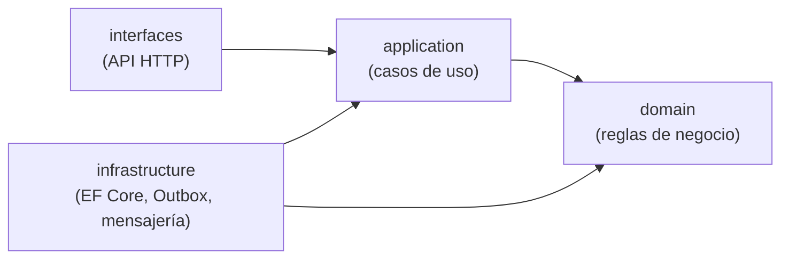

# ShareWay · Trip Execution Service

Microservicio del bounded context **Trip Execution** de **ShareWay**, una plataforma de viajes compartidos programados en Lima (tipo Uber, pero con viaje compartido). Se encarga de la **ejecución del viaje**: validar el abordaje de los pasajeros, iniciar y finalizar el viaje, y publicar los eventos que el resto del ecosistema necesita.

> El contexto original del diagrama es *Trip Execution & Notifications*. Este servicio implementa la parte de **Trip Execution**. Las **notificaciones** quedan fuera: se resolverán en un servicio aparte que consumirá los eventos que este servicio publica.

---

## Tabla de contenidos

1. [Alcance y responsabilidades](#1-alcance-y-responsabilidades)
2. [Arquitectura](#2-arquitectura)
3. [Modelo de dominio](#3-modelo-de-dominio)
4. [Eventos e integración](#4-eventos-e-integración)
5. [API HTTP](#5-api-http)
6. [Dependencias y stack](#6-dependencias-y-stack)
7. [Servicios de infraestructura](#7-servicios-de-infraestructura)
8. [Configuración](#8-configuración)
9. [Cómo ejecutarlo](#9-cómo-ejecutarlo)
10. [Documentación de la API](#10-documentación-de-la-api)
11. [Base de datos](#11-base-de-datos)
12. [Despliegue en Render](#12-despliegue-en-render)
13. [Decisiones de diseño](#13-decisiones-de-diseño)
14. [Limitaciones y próximos pasos](#14-limitaciones-y-próximos-pasos)

---

## 1. Alcance y responsabilidades

| Dentro del servicio | Fuera del servicio |
|---|---|
| Crear el viaje a partir de un grupo confirmado | Matching y armado de grupos (*Ride Booking & Matching*) |
| Validar el abordaje con código QR/PIN, con límite de intentos | Propuestas y rutas del conductor (*Driver Operations & Routing*) |
| Iniciar, finalizar y cancelar el viaje | Cálculo y cobro de tarifas (*Pricing & Payments*) |
| Publicar eventos de integración (Outbox) | Alertas de emergencia y calificaciones (*Safety, Trust & Reputation*) |
| Consumir `GrupoConfirmado` de forma idempotente | Envío de notificaciones (servicio futuro) |

Los demás contextos se relacionan con este solo **por identificadores** (`GrupoId`, `ConductorId`, `ReservaId`, `PasajeroId`) y **por eventos**; nunca por referencias a objetos de otro contexto.

---

## 2. Arquitectura

Se aplica **DDD táctico + Clean Architecture** en un **único proyecto** (`shareway-trip-execution-service.csproj`) organizado por carpetas.



**Regla de dependencia:** las flechas apuntan hacia el dominio. `domain` no conoce a nadie; `application` solo conoce a `domain`; `infrastructure` e `interfaces` dependen hacia adentro.

### Estructura de carpetas

```
TripExecution/
├── domain/
│   ├── SeedWork/            Entidad, raíz de agregado, eventos y excepciones base
│   └── viajes/              Aggregate Viaje, entidades, value objects, eventos, puertos
├── application/
│   ├── Abstracciones/       Puertos: unidad de trabajo, manejadores de comando/consulta
│   ├── Viajes/              Comandos y consultas (un caso de uso por carpeta)
│   ├── EventosDeIntegracion/  Contratos entrantes y salientes + mapeador
│   └── Excepciones/
├── infrastructure/
│   ├── Persistencia/        DbContext, configuraciones EF, repositorios, Outbox
│   └── Mensajeria/          Procesador del Outbox, adaptador de broker, consumidores
├── interfaces/
│   ├── Endpoints/           Minimal APIs
│   ├── Contratos/           Requests/responses HTTP
│   └── Middleware/          Manejo global de excepciones (ProblemDetails)
├── Program.cs               Composición de dependencias y arranque
├── Dockerfile
├── docker-compose.yml
└── appsettings*.json
```

### Patrones aplicados

| Patrón | Dónde |
|---|---|
| **Aggregate Root** | `Viaje`: único punto de entrada para modificar su estado interno |
| **Value Objects** | `CodigoAbordaje` (hash del PIN/QR) y los identificadores tipados |
| **Eventos de dominio** | El aggregate los levanta en cada transición de estado |
| **CQRS ligero** | Comandos (cambian estado, pasan por el aggregate) separados de consultas |
| **Outbox** | Los eventos se guardan en la misma transacción que el cambio de estado |
| **Repositorio + Unidad de trabajo** | Puertos en `domain`/`application`, implementados en `infrastructure` |
| **Concurrencia optimista** | Token de versión en `Viaje` para evitar saltarse el límite de intentos |

> **Importante:** al ser un solo ensamblado, el compilador ya no impide que una capa dependa de otra. Mantén la disciplina: **toda mutación del aggregate entra por `Viaje`** y `domain` no debe importar nada de `application`, `infrastructure` ni `interfaces`. Conviene reforzarlo con un test de arquitectura (NetArchTest filtrando por namespace).

---

## 3. Modelo de dominio

### Aggregate `Viaje`

Representa la ejecución de un viaje confirmado.

| Elemento | Tipo | Descripción |
|---|---|---|
| `Viaje` | Aggregate Root | Estado del viaje, conductor, grupo e instantes reales de inicio y fin |
| `Abordaje` | Entidad (interna) | Una por reserva: código, intentos fallidos, método y hora de abordaje |
| `CodigoAbordaje` | Value Object | Código almacenado solo como **hash** (SHA-256) |
| `EstadoViaje` | Enum | `Confirmado → EnCurso → Finalizado` o `Cancelado` |
| `MetodoAbordaje` | Enum | `Qr`, `Pin` |
| `ResultadoAbordaje` | Enum | `Abordado`, `YaAbordado`, `CodigoInvalido`, `Bloqueado` |

### Reglas de negocio (invariantes)

- Solo el **conductor asignado** puede operar el viaje.
- Transiciones válidas: `Confirmado → EnCurso → Finalizado`, o `Confirmado → Cancelado`.
- No se puede iniciar un viaje sin al menos un pasajero abordado.
- Un abordaje se **bloquea tras 3 intentos fallidos**.
- Un código inválido **no lanza excepción**: devuelve `CodigoInvalido` para que el intento quede persistido.
- El abordaje es idempotente: repetirlo devuelve `YaAbordado`.

### Eventos de dominio

`ViajeCreado` · `ViajeIniciado` · `PasajeroAbordo` · `AbordajeFallido` · `ViajeFinalizado` · `ViajeCancelado`

### Lenguaje ubicuo

El código usa el vocabulario del negocio en **español** (`Viaje`, `Abordaje`, `Conductor`, `Reserva`), igual que el modelo de dominio del proyecto. Se evita mezclar con términos en inglés dentro del dominio.

---

## 4. Eventos e integración

### Evento entrante

| Evento | Origen | Efecto |
|---|---|---|
| `GrupoConfirmado` | Ride Booking & Matching | Crea el `Viaje` en estado `Confirmado`. **Idempotente** (un grupo genera un único viaje, protegido también por índice único en BD). |

El contrato incluye `grupoId`, `conductorId` y, por cada pasajero, `reservaId`, `pasajeroId` y `codigoHash`. Este servicio **nunca ve el código en claro** hasta que el conductor lo escanea o digita.

### Eventos salientes (Outbox)

Los eventos de dominio se traducen a **eventos de integración** (contrato público, solo tipos primitivos) y se guardan en la tabla `outbox` dentro de la misma transacción. Un proceso en segundo plano (`ProcesadorOutbox`) los publica cada ~2 segundos con semántica *al menos una vez*, por lo que los consumidores deben ser idempotentes (cada evento lleva `IdEvento`).

| Evento de integración | Consumidores previstos |
|---|---|
| `ViajeCreado` | — |
| `ViajeIniciado` | Notifications, Safety |
| `PasajeroAbordo` | Notifications |
| `AbordajeFallido` | Safety |
| `ViajeFinalizado` | Pricing & Payments, Reputación, Notifications |
| `ViajeCancelado` | Notifications, Pricing |

> Hoy el adaptador de broker (`IBrokerDeMensajes`) **escribe en el log** (`[BROKER] ...`). Para producción hay que implementarlo contra el broker real (RabbitMQ, Azure Service Bus, Kafka…).

---

## 5. API HTTP

Base: `/api/viajes`. Los comandos devuelven `204 No Content` (o el resultado correspondiente) y los errores usan **ProblemDetails** (RFC 9457).

| Método | Ruta | Descripción |
|---|---|---|
| `POST` | `/api/viajes` | Crea un viaje. En producción nace del evento `GrupoConfirmado`; este endpoint permite simularlo |
| `GET` | `/api/viajes/{id}` | Consulta un viaje con sus abordajes |
| `POST` | `/api/viajes/{id}/abordajes` | Valida el código de abordaje de una reserva |
| `POST` | `/api/viajes/{id}/iniciar` | Inicia el viaje |
| `POST` | `/api/viajes/{id}/finalizar` | Finaliza el viaje |
| `POST` | `/api/viajes/{id}/cancelar` | Cancela el viaje (solo si está `Confirmado`) |
| `GET` | `/health` | Chequeo de salud |

### Mapeo de errores

| Situación | Código HTTP |
|---|---|
| Viaje inexistente | `404` |
| Conductor no asignado al viaje | `403` |
| Regla de negocio violada / transición inválida / conflicto de concurrencia | `409` |
| Datos de entrada inválidos | `400` |
| Error inesperado | `500` |

> **Pendiente de seguridad:** hoy `conductorId` viaja en el body. Debe obtenerse del token (claim `sub`) cuando se integre la autenticación.

---

## 6. Dependencias y stack

| Componente | Versión / detalle |
|---|---|
| Plataforma | **.NET 10** / ASP.NET Core (Minimal APIs) |
| Lenguaje | C# (versión más reciente del SDK) |
| Persistencia | **Entity Framework Core 10** + proveedor **Npgsql** |
| Base de datos | **PostgreSQL 17** |
| Documentación API | OpenAPI nativo de .NET (`AddOpenApi`) |
| Contenedores | Docker y Docker Compose |
| Hosting de pruebas | Render |

Las versiones exactas están en el `.csproj`. Para revisar actualizaciones: `dotnet list package --outdated`.

**Sin dependencias de mensajería ni de CQRS de terceros:** los manejadores de comandos y consultas son clases propias (sin MediatR) y el broker está detrás de una interfaz.

---

## 7. Servicios de infraestructura

| Servicio | Rol | Local | Puerto |
|---|---|---|---|
| `db` | PostgreSQL con la base `shareway_trip_execution` | Docker Compose | `5432` |
| `api` | Este microservicio | `dotnet run` o Docker Compose | `5223` (dotnet run) / `8080` (Docker) |
| Broker | Publicación de eventos de integración | Adaptador que escribe en el log | — |

---

## 8. Configuración

| Variable | Descripción | Ejemplo |
|---|---|---|
| `ConnectionStrings__TripExecution` | Conexión a PostgreSQL. Acepta formato Npgsql o URL `postgresql://` | `Host=localhost;Port=5432;Database=shareway_trip_execution;Username=postgres;Password=postgres` |
| `ASPNETCORE_ENVIRONMENT` | Entorno. En `Development` se crean las tablas al arrancar y se expone OpenAPI | `Development` |
| `PORT` | Puerto de escucha (lo usa Render) | `8080` |

Los valores por defecto están en `appsettings.json` y `appsettings.Development.json`.

---

## 9. Cómo ejecutarlo

**Requisitos:** .NET 10 SDK y Docker.

### Opción A — Base de datos en Docker y API con `dotnet run` (desarrollo)

```bash
docker compose up -d db
ASPNETCORE_ENVIRONMENT=Development dotnet run
```

La API queda en `http://localhost:5223`.

### Opción B — Todo en Docker

```bash
docker compose up --build
```

La API queda en `http://localhost:8080`. No combines las opciones A y B a la vez.

### Probar el flujo completo

```bash
URL=http://localhost:5223
CONDUCTOR=11111111-1111-1111-1111-111111111111
RESERVA=22222222-2222-2222-2222-222222222222
HASH=$(echo -n 482913 | sha256sum | cut -d' ' -f1)

# 1) Crear el viaje (simula el evento GrupoConfirmado)
curl -X POST $URL/api/viajes -H "Content-Type: application/json" -d '{
  "grupoId": "33333333-3333-3333-3333-333333333333",
  "conductorId": "'$CONDUCTOR'",
  "pasajeros": [{ "reservaId": "'$RESERVA'", "pasajeroId": "44444444-4444-4444-4444-444444444444", "codigoHash": "'$HASH'" }]
}'
ID=<id devuelto>

# 2) Validar abordaje, iniciar, finalizar y consultar
curl -X POST $URL/api/viajes/$ID/abordajes -H "Content-Type: application/json" \
  -d '{"conductorId":"'$CONDUCTOR'","reservaId":"'$RESERVA'","codigo":"482913","metodo":"Pin"}'
curl -X POST $URL/api/viajes/$ID/iniciar   -H "Content-Type: application/json" -d '{"conductorId":"'$CONDUCTOR'"}'
curl -X POST $URL/api/viajes/$ID/finalizar -H "Content-Type: application/json" -d '{"conductorId":"'$CONDUCTOR'"}'
curl $URL/api/viajes/$ID
```

Para detener todo: `Ctrl+C` en la API y `docker compose stop db` (conserva datos) o `docker compose down -v` (borra también los datos).

---

## 10. Documentación de la API

Con la API en `Development`:

| Recurso | URL (local con `dotnet run`) |
|---|---|
| Documento OpenAPI (JSON) | `http://localhost:5223/openapi/v1.json` |
| Chequeo de salud | `http://localhost:5223/health` |

El documento OpenAPI se puede importar en Postman o Insomnia. Si se instala una interfaz como **Scalar** (`Scalar.AspNetCore`) o Swagger UI, se publicará en `/scalar/v1` o `/swagger`.

---

## 11. Base de datos

- **Motor:** PostgreSQL 17. **Esquema:** `trip_execution`.
- **Creación de tablas:** en `Development` se ejecuta `EnsureCreated` al arrancar. Para entornos reales se deben usar **migraciones** (`dotnet ef migrations add Inicial` / `dotnet ef database update`); no mezcles ambos mecanismos.

| Tabla | Contenido |
|---|---|
| `viajes` | Aggregate raíz (índice único por `GrupoId`, token de concurrencia `Version`) |
| `abordajes` | Un registro por reserva confirmada (hash del código, intentos, hora de abordaje) |
| `outbox` | Eventos de integración pendientes y publicados |

### Consultar los datos

```bash
docker compose exec db psql -U postgres -d shareway_trip_execution
```

```sql
\dt trip_execution.*
select "Id", "GrupoId", "Estado", "InicioReal" from trip_execution.viajes;
select "Tipo", "OcurridoEn", "ProcesadoEn" from trip_execution.outbox order by "OcurridoEn";
```

Las columnas se crean en **PascalCase**, por lo que en SQL van entre comillas dobles (`"Estado"`). Para evitarlo se puede adoptar `snake_case` con el paquete `EFCore.NamingConventions`.

La base **no trae datos de ejemplo**: arranca vacía y se llena al usar la API.

---

## 12. Decisiones de diseño

| Decisión | Motivo |
|---|---|
| **Un solo proyecto con carpetas** | Un único aggregate y pocos casos de uso no justifican 4 ensamblados; se reduce la ceremonia. Contrapartida: la regla de dependencia deja de ser impuesta por el compilador |
| **Trip Execution separado de Notifications** | Notificaciones es un subdominio genérico, con ritmo de cambio y escalado distintos; consume eventos de todos los contextos |
| **Eventos de dominio ≠ eventos de integración** | El modelo interno puede cambiar sin romper el contrato público con otros servicios |
| **Outbox** | Evita guardar el viaje y perder el evento (o publicar un evento de un cambio que no se guardó) |
| **Código de abordaje como hash** | Booking entrega solo el hash; este servicio nunca almacena el código en claro |
| **Resultado en vez de excepción para códigos inválidos** | El intento fallido debe persistirse para aplicar el límite de intentos |
| **Concurrencia optimista (`Version`)** | Evita que requests simultáneos eludan el bloqueo por intentos |
| **Sin MediatR ni bus interno** | Menos dependencias; los endpoints invocan directamente a los manejadores |
| **Referencias entre contextos solo por Id** | Bajo acoplamiento entre bounded contexts |

